# wavy: entity relationship diagram

This diagram shows the core relations. Audit, notification and integration tables are left out because they have no FKs worth drawing. Column lists show keys and the main business fields. Full definitions are in `supabase/migrations/` and [SCHEMA.md](SCHEMA.md).

```mermaid
erDiagram
  AUTH_USERS ||--|| PROFILES : "id"
  PROFILES ||--o| STAFF_MEMBERS : "user_id"
  ROLE_PERMISSIONS }o--|| PERMISSIONS : "permission"

  CATEGORIES ||--o{ CATEGORIES : "parent_id"
  CATEGORIES ||--o{ PRODUCTS : "category_id"
  COLLECTIONS ||--o{ COLLECTION_PRODUCTS : ""
  PRODUCTS ||--o{ COLLECTION_PRODUCTS : ""
  PRODUCTS ||--o{ PRODUCT_VARIANTS : "product_id"
  PRODUCTS ||--o{ PRODUCT_MEDIA : "product_id"
  PRODUCT_VARIANTS ||--|| INVENTORY : "variant_id"
  PRODUCT_VARIANTS ||--o{ INVENTORY_RESERVATIONS : ""
  PRODUCT_VARIANTS ||--o{ INVENTORY_MOVEMENTS : ""
  PRODUCTS ||--o{ PRODUCT_ATTRIBUTE_VALUES : ""
  ATTRIBUTES ||--o{ ATTRIBUTE_VALUES : ""
  ATTRIBUTE_VALUES ||--o{ PRODUCT_ATTRIBUTE_VALUES : ""
  PRODUCTS ||--o{ RELATED_PRODUCTS : ""
  PROFILES ||--o{ WISHLIST_ITEMS : ""
  PRODUCTS ||--o{ WISHLIST_ITEMS : ""

  PROFILES ||--o{ ADDRESSES : ""
  PROFILES ||--o{ CARTS : "user_id (or session_id)"
  CARTS ||--o{ CART_ITEMS : ""
  PRODUCT_VARIANTS ||--o{ CART_ITEMS : ""
  CARTS ||--o{ CHECKOUT_SESSIONS : ""
  SHIPPING_ZONES ||--o{ SHIPPING_METHODS : ""

  CHECKOUT_SESSIONS ||--o| ORDERS : "checkout_session_id"
  PROFILES ||--o{ ORDERS : "user_id (null = guest)"
  ORDERS ||--|{ ORDER_ITEMS : ""
  ORDERS ||--o{ ORDER_STATUS_HISTORY : ""
  ORDERS ||--o{ INVENTORY_RESERVATIONS : "order_id"
  ORDERS ||--o{ PAYMENTS : "one series per provider"
  PAYMENTS ||--o{ PAYMENT_ATTEMPTS : ""
  ORDERS ||--o{ PAYMENT_EVENTS : ""
  PAYMENTS ||--o{ REFUNDS : ""
  PAYMENT_GATEWAYS ||..o{ PAYMENTS : "provider"

  ORDERS ||--o{ SHIPMENTS : ""
  SHIPMENTS ||--o{ SHIPMENT_EVENTS : ""
  SHIPMENTS ||--o{ SHIPMENT_ITEMS : ""
  ORDER_ITEMS ||--o{ SHIPMENT_ITEMS : ""
  ORDERS ||--o{ RETURN_REQUESTS : ""
  RETURN_REQUESTS ||--|{ RETURN_ITEMS : ""
  ORDER_ITEMS ||--o{ RETURN_ITEMS : ""
  RETURN_REQUESTS ||--o{ RETURN_EVIDENCE : ""
  RETURN_REQUESTS ||--o{ REFUNDS : ""

  PRODUCTS ||--o{ REVIEWS : ""
  PROFILES ||--o{ REVIEWS : ""
  ORDER_ITEMS ||--o{ REVIEWS : "verified via"
  REVIEWS ||--o{ REVIEW_MEDIA : ""
  REVIEWS ||--o{ REVIEW_VOTES : ""

  COUPONS ||--o{ DISCOUNT_TARGETS : ""
  OFFERS ||--o{ DISCOUNT_TARGETS : ""
  COUPONS ||--o{ COUPON_REDEMPTIONS : ""
  ORDERS ||--o| COUPON_REDEMPTIONS : "unique order_id"
  OFFERS ||--o{ OFFER_REDEMPTIONS : ""
  ORDERS ||--o{ OFFER_REDEMPTIONS : ""
  CAMPAIGNS }o--o| COUPONS : ""
  CAMPAIGNS }o--o| OFFERS : ""
  CAMPAIGNS ||--o{ CAMPAIGN_PRODUCTS : ""
  CAMPAIGNS ||--o{ CAMPAIGN_COLLECTIONS : ""

  BLOG_CATEGORIES ||--o{ BLOG_POSTS : ""
  BLOG_POSTS ||--o{ BLOG_POST_TAGS : ""
  BLOG_TAGS ||--o{ BLOG_POST_TAGS : ""
  LOOKBOOK_ENTRIES ||--o{ LOOKBOOK_ENTRY_PRODUCTS : ""
  PRODUCTS ||--o{ LOOKBOOK_ENTRY_PRODUCTS : ""

  PROFILES ||--o{ VISITOR_SESSIONS : "user_id"
  VISITOR_SESSIONS ||..o{ ANALYTICS_EVENTS : "visitor_session_id (no FK)"
  PROFILES ||--o{ SUPPORT_TICKETS : ""
  ORDERS ||--o{ SUPPORT_TICKETS : ""
  PAYMENTS ||--o{ SUPPORT_TICKETS : ""
  SUPPORT_TICKETS ||--o{ SUPPORT_TICKET_MESSAGES : ""
  PRODUCTS ||--o{ TRYON_SESSIONS : ""
  PROFILES ||--o{ TRYON_SESSIONS : ""

  PROFILES {
    uuid id PK
    text email
    user_role role
    account_status status
  }
  STAFF_MEMBERS {
    uuid id PK
    uuid user_id FK
    text email UK
    user_role role
    staff_status status
  }
  PRODUCTS {
    uuid id PK
    uuid category_id FK
    text slug UK
    product_status status
    int price_min
    numeric rating_avg
    tsvector search_vector
  }
  PRODUCT_VARIANTS {
    uuid id PK
    uuid product_id FK
    text sku UK
    text color
    text size
    int price
    variant_status status
  }
  INVENTORY {
    uuid variant_id PK
    int on_hand
    int reserved
    int available
  }
  ORDERS {
    uuid id PK
    text order_number UK
    text idempotency_key UK
    order_status status
    payment_status payment_status
    int subtotal
    int discount_total
    int shipping_total
    int tax_total
    int total
    text tracking_token UK
  }
  PAYMENTS {
    uuid id PK
    uuid order_id FK
    payment_provider provider
    payment_status status
    int amount_captured
  }
  PAYMENT_ATTEMPTS {
    uuid id PK
    uuid payment_id FK
    int attempt_no
    payment_attempt_status status
    payment_failure_stage failure_stage
    text failure_code
  }
  PAYMENT_EVENTS {
    uuid id PK
    payment_provider provider
    text provider_event_id "UK with provider"
    text event_type
  }
  COUPONS {
    uuid id PK
    text code "UK upper(code)"
    coupon_type type
    int value
  }
  OFFERS {
    uuid id PK
    offer_type type
    int required_qty
    int bundle_price
  }
  ANALYTICS_EVENTS {
    uuid id PK
    timestamptz created_at PK "partition key"
    analytics_event_name event_name
    jsonb properties
  }
```

