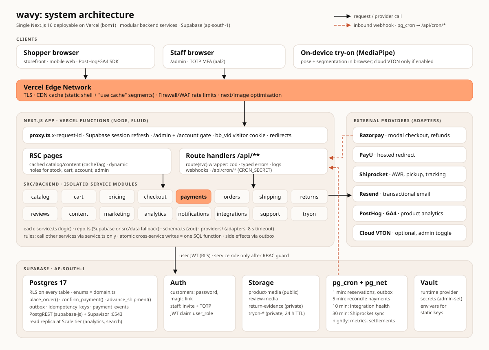
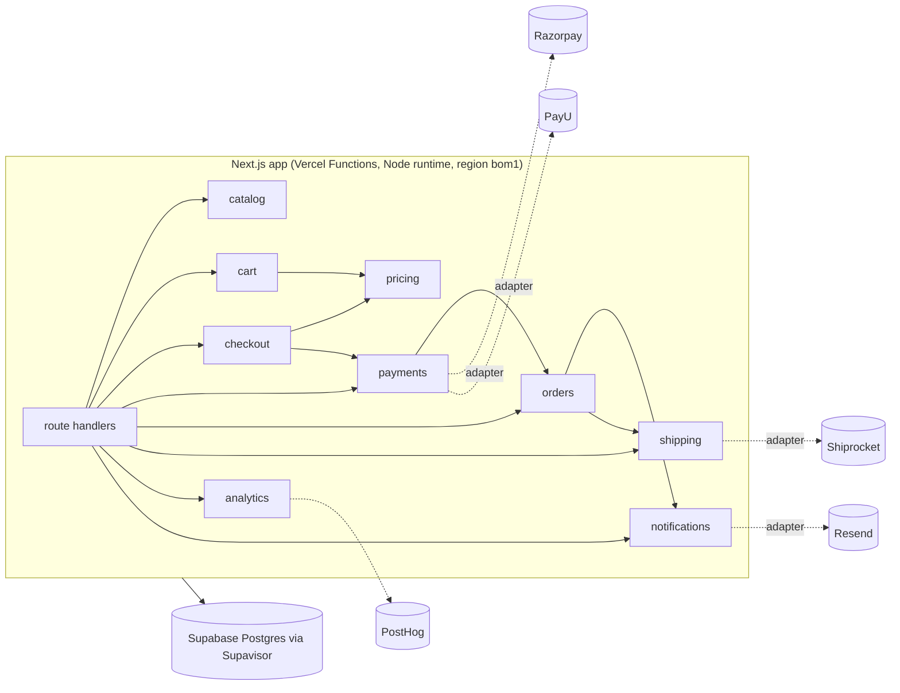

# 01 · Architecture

wavy is one Next.js 16 app on Vercel plus one Supabase project. The backend is split into
**modules** under `src/backend/<svc>` ("microservices in one deployable"). They share the
process and database but not code paths, error boundaries or failure modes.



## 1. Components

| Layer | Tech | Responsibility |
|---|---|---|
| Edge / CDN | Vercel Edge Network | TLS, HTTP/3, static assets, cached RSC/HTML, image optimisation (`next/image`), WAF + firewall rules, bot protection |
| Proxy | `src/proxy.ts` (Next 16 successor to `middleware.ts`) | request id (`x-request-id`), session refresh (`@supabase/ssr`), `/admin/**` + `/account/**` gate, visitor id cookie `bb_vid` |
| Rendering | React Server Components, Cache Components (`"use cache"`) | storefront pages, admin pages |
| API | `src/app/api/**/route.ts` via `route(svc, handler)` | thin HTTP adapters: parse (zod) → call service → `ok()` / `ApiError` |
| Data | Supabase Postgres 17 + Supavisor | source of truth, RLS, SQL functions for atomic inventory/coupon ops, `pg_cron`, `pg_net` |
| Auth | Supabase Auth | customer email/password + magic link, staff invite, JWT with `app_metadata.role` |
| Providers | Razorpay, PayU, Shiprocket, Resend, PostHog, GA4, cloud VTON (optional) | each behind an adapter in `src/backend/<svc>/providers/` |

## 2. Service map and failure isolation



Rules that keep modules isolated:

1. **One service, one `route()` wrapper.** An exception is caught, logged as `request.crashed` with `svc` + `requestId`, and returned as `500 internal_error (ref xxxxxxxx)`. No shared mutable state between services.
2. **Services call each other through exported functions in `service.ts` only**, never each other's `repo.ts`. Cross-service writes that must be atomic live in one Postgres function (e.g. `place_order()`, `confirm_payment()`), not in JS.
3. **Side effects go through the outbox.** `orders` writes a row to `outbox` in the same transaction; `notifications`, `analytics` and `shipping` consume it. If Resend is down, the order still commits; the email retries.
4. **Every provider call has a timeout and a status.** Default 8 s (`AbortSignal.timeout`), 2 retries with jitter for idempotent GETs only. Failures flip `integration_configs.status` to `needs_attention` after 3 consecutive errors (see 05).
6. **Const fallback** (`hasSupabase === false`) returns `src/data/*` so the storefront renders in local dev and preview without a DB.

## 3. Request lifecycle

```mermaid
sequenceDiagram
  autonumber
  participant B as Browser
  participant E as Vercel Edge
  participant P as proxy.ts
  participant RSC as Page (RSC)
  participant API as /api route()
  participant S as backend service
  participant DB as Postgres (Supavisor)
  B->>E: GET /products/core-tee
  E-->>B: HIT: cached static shell + cached catalog segments
  E->>P: MISS / dynamic hole
  P->>P: set x-request-id, refresh Supabase cookie, bb_vid
  P->>RSC: render
  RSC->>S: catalog.getProduct(slug) ("use cache", tag product:<id>)
  S->>DB: select … (anon key, RLS: status = published)
  RSC-->>B: streamed HTML/RSC; cart badge + price-in-cart stream later
  B->>API: POST /api/cart/items {variantId, qty}
  API->>API: route("cart"): requestId, logger.child, zod parse
  API->>S: cart.addItem()
  S->>DB: upsert cart_items, check stock
  API-->>B: {ok:true,data:{lines,totals}} + x-request-id
```

The `x-request-id` minted in `proxy.ts` is forwarded to route handlers and returned to the
browser; error toasts show its first 8 chars so support can grep logs (see 05).

## 4. Rendering strategy per page type

`next.config.ts`: `cacheComponents: true`. Static shell + cached data + dynamic holes (Partial Prerendering).

| Route | Strategy | Cache | Invalidation |
|---|---|---|---|
| `/` home, `/lookbook`, `/about`, `/faq`, `/journal`, `/journal/[slug]` | static shell, cached data | `cacheLife('hours')`, tags `home`, `content:<slug>`, `blog` | admin publish → `revalidateTag(tag,'max')` |
| `/collections/[slug]`, `/clothing`, `/sneakers` | static shell + cached grid; filters in `searchParams` are a dynamic hole | `cacheLife('hours')`, tags `collection:<id>`, `catalog` | product/variant/collection save |
| `/products/[slug]` | cached product, reviews summary; stock badge + delivery ETA + "in bag" are dynamic holes | tags `product:<id>`, `reviews:<productId>` | product save, stock change crossing 0 / low-stock threshold, review approve |
| `/search` | dynamic, results query cached per normalised query 5 min | `cacheLife('minutes')`, tag `catalog` | catalog change |
| `/cart`, `/checkout/**`, `/order/[number]/success` | fully dynamic, `no-store` | none | n/a |
| `/account/**` | dynamic, per-user, `private` | none | n/a |
| `/track/[token]` | dynamic; API response `Cache-Control: private, max-age=60` | none server-side | n/a |
| `/admin/**` | dynamic, per-staff, never cached | none | n/a |
| `/sitemap.xml`, `/robots.txt` | route handler, cached | `cacheLife('days')`, tag `seo` | product/blog publish, SEO settings |
| Product media | Supabase Storage public bucket → `next/image` | CDN immutable (hashed file names) | new upload = new URL |

**Never cached**: cart, prices shown in cart/checkout, coupon validation, payment endpoints,
stock at checkout, anything reading cookies. Catalog pages show list prices from cache; the
authoritative price is re-computed by `pricing` at cart and checkout time.

Tag naming: `catalog`, `product:<uuid>`, `collection:<uuid>`, `category:<uuid>`,
`reviews:<productId>`, `content:<slug>`, `blog`, `home`, `seo`, `settings:storefront`.
Admin mutations call `updateTag()` inside Server Actions (read-your-writes for the editor) and
`revalidateTag(tag, 'max')` from route handlers / webhooks.

## 5. Data and storage

- All money is integer paise (`bigint` in SQL, `number` in TS). All ids `uuid`. All timestamps `timestamptz`.
- Enums in `src/types/domain.ts` mirror Postgres enums one-to-one.
- Snapshots: `orders` and `order_items` copy name/price/tax/discount/address at placement; they never join back to live catalog for totals.
- Heavy analytics (`analytics_events`, `visitor_sessions`) are **partitioned monthly** (`pg_partman` or manual), retained 13 months raw; aggregates in `daily_metrics`.
- Supabase clients: `lib/supabase/server.ts` (user JWT, RLS applies), `lib/supabase/admin.ts` (service role, **server-only**, used by webhooks/cron/admin services after the RBAC guard).

## 6. Jobs and queues

| Job | Schedule | Runs as | Does |
|---|---|---|---|
| `release_expired_reservations()` | `pg_cron` every 1 min | SQL | frees `inventory_reservations` past `expires_at` (15 min) for orders still `pending_payment`, sets attempt `failure_stage = 'abandoned'` |
| `reconcile-payments` | every 5 min | `pg_net` → `GET /api/cron/reconcile-payments` | polls provider for attempts `initiated`/`authorized` older than 10 min (see 03) |
| `outbox-flush` | every 1 min | `pg_net` → `/api/cron/outbox` | delivers emails, PostHog server events, Shiprocket order creation; exponential backoff, max 8 tries → `dead` |
| `shiprocket-sync` | every 30 min | `/api/cron/shiprocket-sync` | pulls tracking for shipments without a webhook in 6 h |
| `integration-health` | every 10 min | `/api/cron/integration-health` | cheap auth-check call per provider, updates `integration_configs.status` |

Cron endpoints require `Authorization: Bearer $CRON_SECRET` and are excluded from `proxy.ts`
session logic. `pg_cron` is used instead of Vercel Cron because it runs per-minute on every
plan and keeps SQL-only jobs inside the DB. Upgrade path: move `outbox` to Supabase Queues
(`pgmq`) when throughput exceeds ~1k messages/min.

## 7. Environments

| Env | Vercel | Supabase | Providers |
|---|---|---|---|
| local | `next dev` | `supabase start` (Docker) or const fallback | test keys / mocks |
| preview | per-PR deployment | Supabase branch (per PR) | test keys |
| production | `main`, region `bom1` (Mumbai) | project in `ap-south-1` | live keys |

Functions run in `bom1` next to the DB in `ap-south-1` to keep the DB round-trip under 5 ms.
