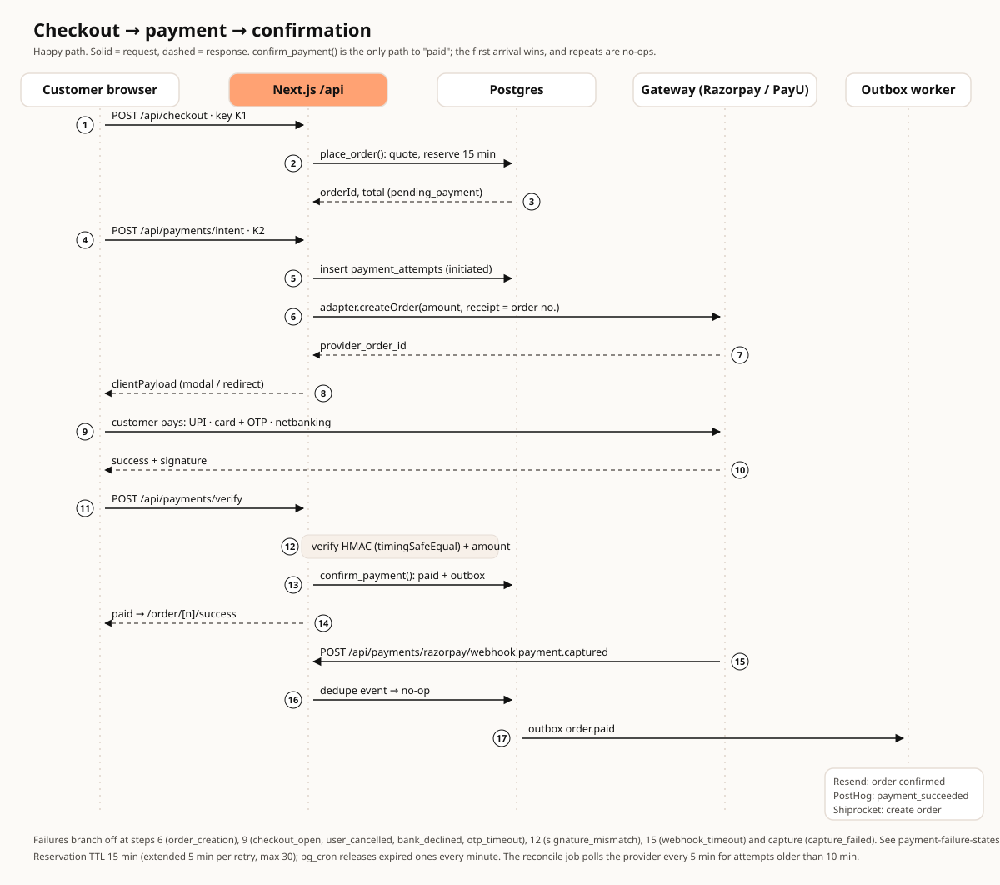
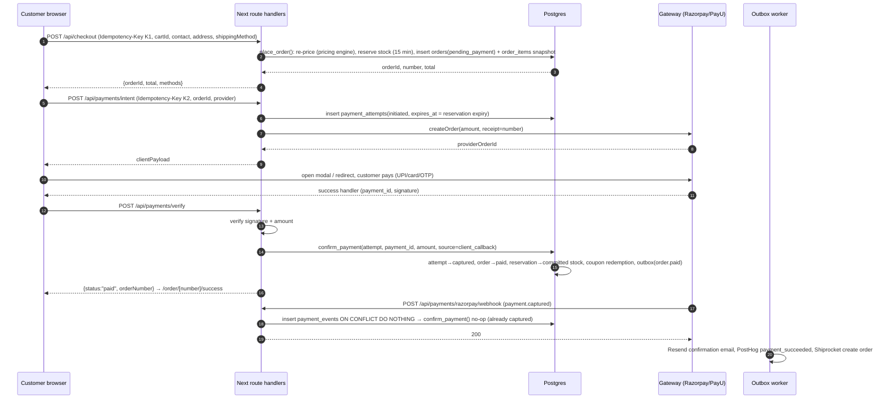
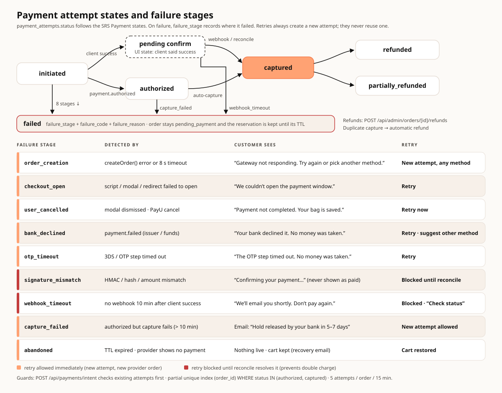
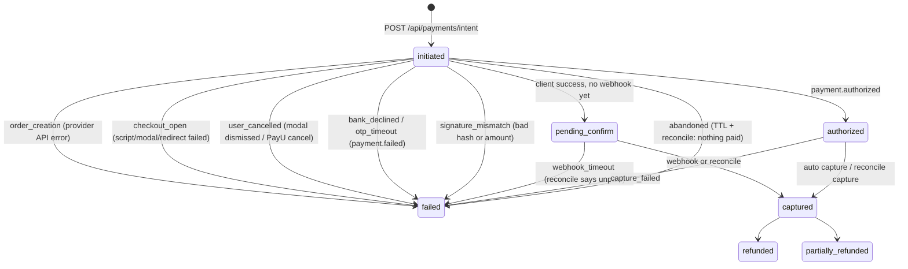

# 03 · Payments

Payments must be gateway-agnostic, idempotent end to end, and debuggable by support in under a
minute. Providers: **Razorpay** (modal checkout), **PayU** (hosted redirect), **COD**. Admin
decides which ones are live and which is the default.



## 1. Data model

| Table | Key columns | Notes |
|---|---|---|
| `payment_gateways` | `provider` (pk, `payment_provider` enum), `enabled`, `is_default`, `display_name`, `sort_order`, `mode` (`test`/`live`), `min_amount`, `max_amount`, `cod_max_amount`, `cod_fee`, `updated_by`, `updated_at` | Partial unique index `WHERE is_default`. Holds no secrets. |
| `payment_attempts` | `id`, `order_id`, `attempt_no`, `provider`, `status` (`payment_status`), `amount`, `currency`, `idempotency_key` (unique), `provider_order_id` (unique), `provider_payment_id` (unique, nullable), `method` (`upi`/`card`/`netbanking`/`wallet`/`emi`/`cod`), `failure_stage`, `failure_code`, `failure_reason`, `expires_at`, `authorized_at`, `captured_at`, `failed_at`, `visitor_id`, `request_id` | One row per attempt to pay. Retries create a new row, which is why this is not `payments`. |
| `payment_events` | `id`, `attempt_id`, `provider`, `source` (`client_callback`/`webhook`/`reconcile`/`admin`), `provider_event_id`, `type`, `signature_valid`, `payload` (jsonb, redacted), `received_at`, `processed_at`, `result` | `UNIQUE (provider, provider_event_id)`. This is the webhook dedupe and the full audit trail. |
| `refunds` | `id`, `attempt_id`, `order_id`, `amount`, `reason`, `provider_refund_id` (unique), `status`, `idempotency_key` (unique), `created_by` | Supports partial refunds; order-level `payment_status` becomes `partially_refunded` or `refunded`. |
| `idempotency_keys` | `key`, `scope`, `request_hash`, `status` (`in_progress`/`done`), `response` (jsonb), `created_at` | 24 h TTL, used by `POST /api/checkout`, `/api/payments/intent`, and admin refunds. |

`failure_stage` enum (Postgres `payment_failure_stage`):
`order_creation · checkout_open · user_cancelled · bank_declined · otp_timeout · signature_mismatch · webhook_timeout · capture_failed · abandoned`.

`abandoned` is a ninth stage, added for attempts where the customer never came back, no webhook
arrived, and reconciliation confirms nothing was paid.

Secrets are **env vars only** (`RAZORPAY_KEY_ID`, `RAZORPAY_KEY_SECRET`, `RAZORPAY_WEBHOOK_SECRET`,
`PAYU_MERCHANT_KEY`, `PAYU_MERCHANT_SALT`, `PAYU_WEBHOOK_SALT`). They are never stored in DB rows and
never returned by any API. `RAZORPAY_KEY_ID` is the only value the browser sees, and it arrives
inside `clientPayload`.

## 2. Provider adapter

`src/backend/payments/providers/{razorpay,payu,cod}.ts`, registered in `providers/index.ts`.

```ts
export interface PaymentProviderAdapter {
  id: PaymentProvider;                         // "razorpay" | "payu" | "cod"
  isConfigured(): boolean;                     // env keys present → admin may enable
  createOrder(i: {
    attemptId: string; amount: number; receipt: string;   // receipt = order number
    customer: { name: string; email: string; phone: string };
  }): Promise<{ providerOrderId: string; clientPayload: ClientPayload }>;
  verifyCallback(body: unknown): Promise<VerifyResult>;    // client return / handler
  parseWebhook(rawBody: string, headers: Headers): Promise<WebhookEvent>; // throws SignatureError
  fetchStatus(providerOrderId: string): Promise<ProviderStatus>;         // reconciliation
  refund(i: { providerPaymentId: string; amount: number; idempotencyKey: string }):
    Promise<{ providerRefundId: string; status: "pending" | "processed" | "failed" }>;
}

type ClientPayload =
  | { kind: "razorpay_modal"; keyId: string; orderId: string; amount: number; prefill: {…} }
  | { kind: "payu_redirect"; action: string; fields: Record<string, string> } // auto-submitted form
  | { kind: "none" };                                                         // COD

type VerifyResult =
  | { ok: true; providerPaymentId: string; amount: number; status: "authorized" | "captured" }
  | { ok: false; stage: FailureStage; code: string; reason: string };
```

| | Razorpay | PayU | COD |
|---|---|---|---|
| Create | `POST /v1/orders` with `payment_capture: 1` (auto-capture) | Local: `txnid = attempt.id`, `hash = sha512(key\|txnid\|amount\|productinfo\|firstname\|email\|udf1..udf5\|\|\|\|\|\|SALT)` | none |
| Client | `checkout.js` modal; `handler` → `POST /api/payments/verify`; `modal.ondismiss` → `POST /api/payments/verify {cancelled:true}` | form POST to PayU; returns to `POST /api/payments/payu/return` (surl/furl) → 303 to `/checkout/payment/status?attempt=…` | none |
| Callback check | `hmac_sha256(order_id + "\|" + payment_id, KEY_SECRET) == razorpay_signature` | reverse hash `sha512(SALT\|status\|\|\|\|\|\|udf5..udf1\|email\|firstname\|productinfo\|amount\|txnid\|key)` | n/a |
| Webhook | `POST /api/payments/razorpay/webhook`, `X-Razorpay-Signature = hmac_sha256(rawBody, WEBHOOK_SECRET)`, id = `x-razorpay-event-id` | `POST /api/payments/payu/webhook`, same reverse-hash check, id = `mihpayid:status` | n/a |
| Events used | `payment.authorized`, `payment.captured`, `payment.failed`, `order.paid`, `refund.processed`, `refund.failed` | `success`, `failure`, `pending`, refund webhook | n/a |
| Status poll | `GET /v1/orders/:id/payments` | `verify_payment` API command | n/a |

All signature comparisons use `crypto.timingSafeEqual`. Webhook handlers read `await req.text()`
**before** any JSON parse, because the signature is computed over the raw bytes.

## 3. Admin: enabling gateways and choosing the default

Screen: `/admin/settings/payments` (permission `settings.payments.manage`, super_admin only).
API: `PATCH /api/admin/payment-gateways/[provider]` with `{ enabled?, isDefault?, sortOrder?, displayName?, minAmount?, maxAmount?, codMaxAmount?, codFee? }`.

Server rules:
1. A gateway can be enabled only if `adapter.isConfigured()` returns true and `integration_configs.status != 'disconnected'`. Otherwise the server returns `409 gateway_not_configured`.
2. At least one gateway must stay enabled, or the server returns `409 last_gateway`.
3. `is_default` must point to an enabled gateway. Disabling the default promotes the enabled gateway with the lowest `sort_order`.
4. COD is offered only when `total ≤ cod_max_amount` (default ₹10,000) and the Shiprocket serviceability response for the pincode includes COD.
5. Disabling a gateway only hides it for **new** attempts. Webhooks, reconciliation and refunds for its existing attempts keep working.
6. Every change writes an `audit_logs` row (`payment_gateway.updated`, before/after) and calls `revalidateTag('settings:payments','max')`.

Checkout reads `GET /api/payments/methods?total=…`, which returns `[{provider, displayName, isDefault, fee}]`.
The default method is preselected. `POST /api/payments/intent` re-checks enablement on the
server, so a stale client cannot pay through a disabled gateway.

## 4. Checkout sequence



### Server steps in detail

| Step | Endpoint / function | Writes | Guarantees |
|---|---|---|---|
| 1. Create order | `POST /api/checkout` → `checkout.placeOrder()` → SQL `place_order(cart_id, payload, idem_key)` | `orders`, `order_items`, `inventory_reservations`, `order_events` | Same `Idempotency-Key` returns the same order. Stock reservation is an atomic conditional `UPDATE`, so no oversell. Totals come only from `pricing.quote()`. |
| 2. Reserve inventory | inside `place_order` | `product_variants.reserved += qty`, `inventory_reservations(expires_at = now()+15m)` | If any line fails, the whole call fails with `409 out_of_stock {variantIds}` |
| 3. Create provider order | `POST /api/payments/intent` → `payments.createIntent()` | `payment_attempts` (`initiated`) → `adapter.createOrder()` → `provider_order_id` | On provider error: `failure_stage = order_creation`, returns `502 gateway_unavailable` and the other enabled methods |
| 4. Client checkout | browser | none; client-side events `payment_modal_opened` go to PostHog | If `checkout.js` fails to load or the modal throws: client calls `POST /api/payments/verify {error:"checkout_open"}` |
| 5. Callback verify | `POST /api/payments/verify` or `POST /api/payments/payu/return` | `payment_events(source=client_callback)` | Bad signature: `signature_mismatch`, **never** marks paid |
| 6. Webhook | `POST /api/payments/{provider}/webhook` | `payment_events(source=webhook)` | Invalid signature: `401`, logged `payment.webhook_bad_signature`. Duplicate event id: `200` and no-op. |
| 7. Capture | auto (Razorpay `payment_capture:1`, PayU is sale-mode) | attempt `authorized → captured` | `authorized` older than 10 min is captured by reconciliation through the capture API, or else `capture_failed` |
| 8. Confirm | SQL `confirm_payment(attempt_id, provider_payment_id, amount, source)` | order `paid`, reservation `committed`, `coupon_redemptions`, `outbox` | `SELECT … FOR UPDATE` on the attempt row; if already `captured`, returns `duplicate`; amount ≠ `attempt.amount` → refuses (`signature_mismatch`, code `amount_mismatch`) |
| 9. Release | `pg_cron release_expired_reservations()` every 1 min; or on terminal failure | reservation `released`, `reserved -= qty`, order stays `pending_payment` until 24 h, then `cancelled` | Customer can retry within 15 min on the same reservation; after that, retry re-reserves |

### Confirm is the single point of truth

`confirm_payment()` is the only code path that moves an order to `paid`. The client callback,
webhook, reconciliation and admin "mark as paid (verified)" all call it. Whichever arrives first
wins and the others are no-ops. We trust a **verified client signature** as sufficient for
Razorpay, so customers are not kept waiting for the webhook. The webhook then confirms the same
state.

### Late payment after the reservation expired

`confirm_payment()` tries to re-reserve. If stock is available, the order becomes `paid` as normal.
If stock is gone, the order becomes `cancelled`, an automatic full refund is created
(`reason = 'stock_unavailable_after_payment'`), and the customer gets an apology email with the
refund ETA (5–7 working days).

## 5. Idempotency and dedupe

| Where | Key | Mechanism |
|---|---|---|
| `POST /api/checkout` | `Idempotency-Key` header. The client generates a uuid when the Pay button is first pressed and keeps it in `sessionStorage` for that cart version. | `idempotency_keys(scope='checkout')`: `in_progress` → `409 request_in_progress`; `done` → replay stored response; same key with a different `request_hash` → `422 idempotency_key_reused` |
| `POST /api/payments/intent` | header K2 per (order, provider, click) | Same table. Also `UNIQUE (order_id) WHERE status IN ('authorized','captured')`, so an order can never hold two successful attempts in the DB. |
| Provider order | `receipt = order number`, `notes.attempt_id` | lets reconciliation map provider records back to attempts |
| Webhooks | `(provider, provider_event_id)` | `INSERT … ON CONFLICT DO NOTHING RETURNING id`; no row returned means the event is a duplicate: `200` and skip |
| Confirm | attempt row lock + status check | repeated calls return `duplicate` |
| Refund | `refunds.idempotency_key = hash(order_id, amount, reason, admin_click_id)`; sent to provider as the idempotency header / `notes` | double-click never double-refunds |
| Outbox | `outbox(dedupe_key)` unique, e.g. `email:order_paid:<orderId>` | one confirmation email per order |

## 6. Failure stages





`pending_confirm` is not a DB status. It is `status='initiated'` with a `client_callback` event
already present, and the UI shows it as "Confirming your payment".

| Stage | Detected by | Recorded as | Customer sees | Retry | Support sees |
|---|---|---|---|---|---|
| `order_creation` | `adapter.createOrder()` throws or times out (8 s) | attempt `failed`, `failure_code = http_<status>` or `timeout`; log `payment.order_create_failed`; integration error counter +1 | "Razorpay is not responding. Try again or choose another method." Other enabled methods are highlighted. | Same order, new attempt, any method. The cart and reservation are untouched. | Order timeline: "Attempt #1 Razorpay failed at order creation (timeout)" |
| `checkout_open` | client reports script load error / modal init error / PayU form failed; or no client signal and the provider shows no payment after 2 min | `failed`, `failure_code = script_load \| modal_error` | "We couldn't open the payment window. Check your connection and try again." | Retry button (new attempt) | Same, plus browser/UA from `visitor_sessions` |
| `user_cancelled` | Razorpay `ondismiss`; PayU `status=failure, error=E000 / "cancelled by user"` | `failed`, `failure_code = dismissed` | Neutral tone, not an error: "Payment not completed. Your bag is saved." Pay again is primary. | Retry immediately | "Customer closed the payment window at 14:02" |
| `bank_declined` | webhook `payment.failed` with `error_reason` in (`payment_failed`, `insufficient_funds`, `card_declined`, …); PayU `failure` with bank code | `failed`, `failure_code = provider error code`, `failure_reason = provider description` | "Your bank declined the payment. No money was taken. Try another card or UPI." | Retry, suggest a different method | Provider error code plus the bank's text |
| `otp_timeout` | `payment.failed` with `error_reason = authentication_timeout / payment_timeout`; PayU `unmappedstatus = userCancelled/timeout` during 3DS | `failed`, `failure_code = otp_timeout` | "The OTP step timed out. No money was taken. Try again." | Retry | Stage and time spent in modal |
| `signature_mismatch` | HMAC or hash check fails on callback or webhook; amount/currency differs from `attempt.amount` | callback: attempt stays `initiated`, `payment_events.signature_valid=false`, log `payment.signature_mismatch` (**error**, alert). Webhook: 401. | "We're confirming your payment" (pending screen). The server then reconciles against the provider. It never shows paid on a bad signature. | Reconcile resolves it within 5 min: if the provider shows captured and the amount matches → confirm; otherwise → failed | Red flag in the order; possible tampering. Payload kept (redacted). |
| `webhook_timeout` | client success recorded but no webhook within 10 min, **or** status `initiated` past `expires_at` with a `client_callback` event | stays `initiated` until reconcile; if the provider says unpaid → `failed` with this stage; if paid → `captured` (stage cleared, event kept) | Pending screen polling `GET /api/payments/attempts/[id]` every 3 s for 60 s, then: "We'll email you within 30 minutes. Don't pay again." | **Retry blocked** while any attempt is pending confirmation. The UI offers "Check status" instead. | "Webhook not received; resolved by reconcile at 14:15" |
| `capture_failed` | attempt `authorized` > 10 min and reconcile capture call fails, or `order.paid` never arrives | `failed` (auth auto-reverses at the provider in ≤ 5 days); alert `payment.capture_failed` | Email: "Your payment couldn't be completed. Any hold on your account will be released by your bank in 5–7 days." | New attempt allowed (the old authorization is not captured, so there is no double charge) | Shows the auth amount and the expected reversal date |
| `abandoned` | `release_expired_reservations()` finds an `initiated` attempt with no client signal; reconcile confirms nothing was paid | `failed`, `failure_stage = abandoned` | Nothing live. An optional cart-recovery email after 1 h, if marketing consent exists. | Cart restored from `cart_id` | Drop-off point comes from PostHog funnel |

### Retry without double charge

1. `POST /api/payments/intent` first loads every attempt for the order:
   - any `captured` or `authorized` → `409 already_paid` (UI redirects to success);
   - any `initiated` with a client success event → `409 confirmation_pending`;
   - any other `initiated` → call `adapter.fetchStatus()` synchronously (≤ 3 s). If paid → confirm and return `already_paid`. Otherwise mark it `failed` (`user_cancelled` or `abandoned`) and continue.
2. It creates a **new** attempt with a **new** provider order. Provider orders are never reused across attempts, so a stale modal cannot pay the new one.
3. Partial unique index `payment_attempts (order_id) WHERE status IN ('authorized','captured')` is the last line of defence. The DB can never show two successful attempts for one order. If the provider still captures twice (the customer paid in two tabs), the second `confirm_payment()` sees the existing captured attempt and handles the second one this way:
   - it does **not** move the second attempt to `captured`;
   - it stores `provider_payment_id` with `failure_code = duplicate_capture`;
   - it creates an automatic full refund (`reason = duplicate_payment`), which moves that attempt straight to `refunded` when `refund.processed` arrives;
   - it emails the customer and logs `payment.duplicate_refunded`.
4. Retries are rate-limited to 5 per order per 15 min.
5. The reservation is kept across retries within the 15-min TTL. Each new attempt extends it by 5 min, up to 30 min total.

## 7. Reconciliation job

`GET /api/cron/reconcile-payments` runs every 5 min via `pg_cron` + `pg_net` with `CRON_SECRET`.

```text
for attempt in payment_attempts
    where status in ('initiated','authorized')
      and created_at < now() - interval '10 minutes'
      and created_at > now() - interval '72 hours'
    order by created_at limit 200:
  s = adapter.fetchStatus(attempt.provider_order_id)
  record payment_events(source='reconcile', provider_event_id = 'reconcile:'||attempt.id||':'||s.status)
  case s.status
    captured   -> confirm_payment(..., source='reconcile')
    authorized -> capture if < 3 days else mark capture_failed
    failed     -> mark failed with mapped stage
    created / no payment and attempt.expires_at < now() -> mark failed (abandoned | webhook_timeout)
```

A nightly `reconcile-settlements` job at 03:00 IST pulls the previous day's Razorpay/PayU
settlement reports and flags every captured provider payment with no matching `captured` attempt,
and every `captured` attempt missing from the settlement. It writes results to
`reconciliation_issues` and the admin dashboard shows the count.

## 8. COD

COD `createOrder()` returns `{kind:"none"}`. `confirm_cod(order_id)`:
- order `pending_payment → processing`, attempt `initiated` (method `cod`), reservation committed;
- sends an OTP/confirmation email or SMS for orders over ₹3,000 (configurable) to cut RTO; if not confirmed in 24 h, the order is flagged for manual call;
- on Shiprocket `delivered` + COD remittance → attempt `captured`; RTO (return to origin) → order `cancelled`, attempt `failed` (`failure_code = cod_rto`).

## 9. Refunds

`POST /api/admin/orders/[id]/refunds {amount, reason, lineItemIds?}` requires permission
`orders.refund`. Refunds above ₹20,000 also need `super_admin`.
The server calls `adapter.refund()` with an idempotency key, inserts `refunds(pending)`, and the
`refund.processed` webhook sets it to `processed` and the order to `refunded` / `partially_refunded`.
COD refunds are recorded as `manual` (bank transfer / UPI payout, outside the gateway) with a UTR reference.

## 10. How support finds a payment

The support console and admin order detail search box (`GET /api/admin/search?q=`) accept an
order number (`BB-24091`), email, phone, Razorpay `pay_…`/`order_…`, PayU `mihpayid`/`txnid`, or
a request-id prefix.

The order detail **Payments** tab reads the view `v_payment_timeline`:

```text
14:01:03  Attempt #1  Razorpay  ₹2,499  initiated        order_P3x…
14:01:05  client      modal opened (Chrome 128, Android)
14:02:41  webhook     payment.failed  bank_declined  "BAD_REQUEST_ERROR: card declined by issuer"
14:03:10  Attempt #2  Razorpay  ₹2,499  initiated        order_P3y…
14:03:52  client      success callback, signature ✓
14:03:52  confirm     captured pay_Q9…  (source: client_callback)
14:03:55  webhook     payment.captured  duplicate → no-op
```

Actions on that tab: **Re-check with gateway** (`POST /api/admin/payments/[attemptId]/reconcile`),
**Refund**, and **Copy customer-safe summary**. Every action is audit-logged.

## 11. Logging and alerts

Event names: `payment.intent_created`, `payment.order_create_failed`, `payment.verify_ok`,
`payment.signature_mismatch`, `payment.webhook_received`, `payment.webhook_duplicate`,
`payment.webhook_bad_signature`, `payment.confirmed`, `payment.failed`, `payment.reconciled`,
`payment.capture_failed`, `payment.duplicate_refunded`, `payment.refund_created`.
Every entry carries `svc=payments`, `requestId`, `orderId`, `attemptId`, `provider`.

Alerts:
- payment failure rate over 25% in 15 min (with at least 20 attempts);
- any `signature_mismatch`;
- no webhook received from an enabled gateway for 60 min while attempts > 0;
- `reconciliation_issues > 0`.
