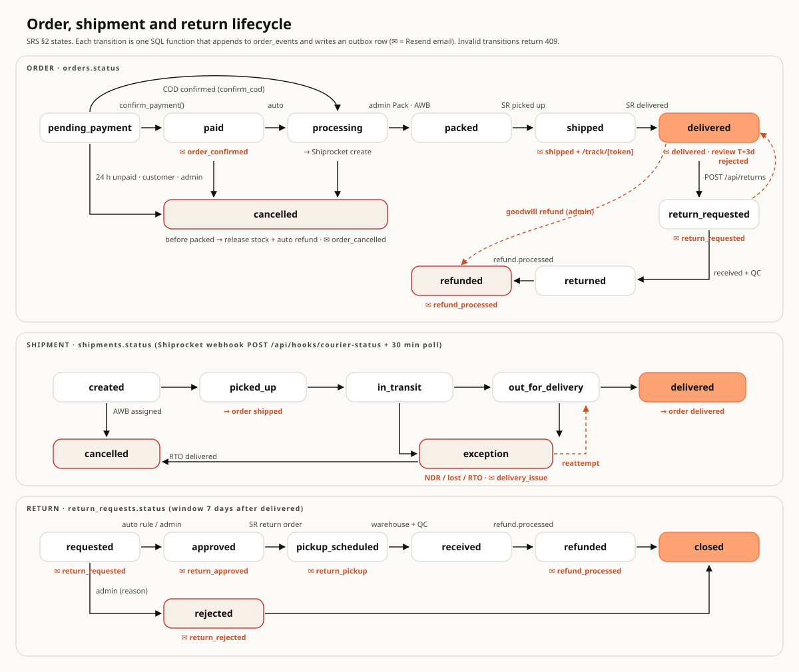
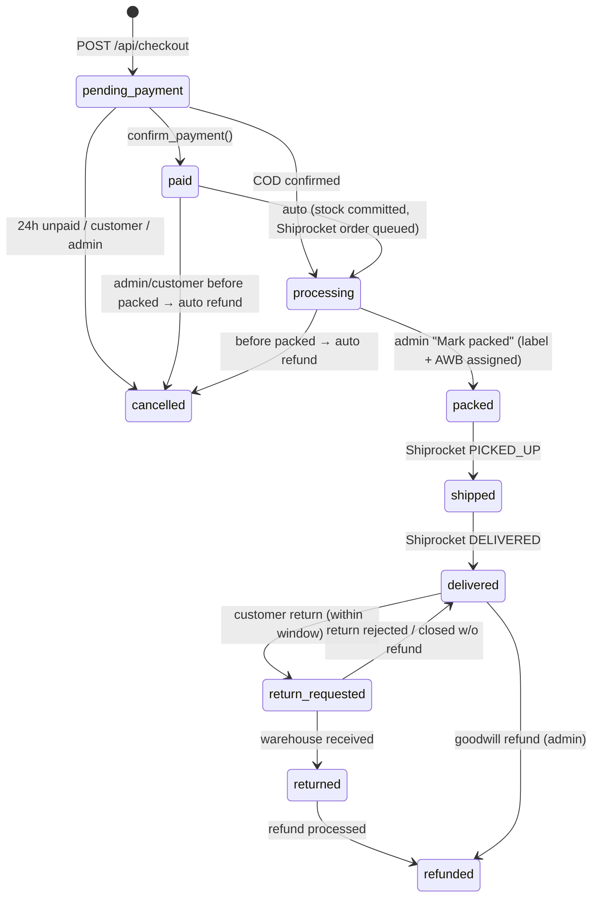
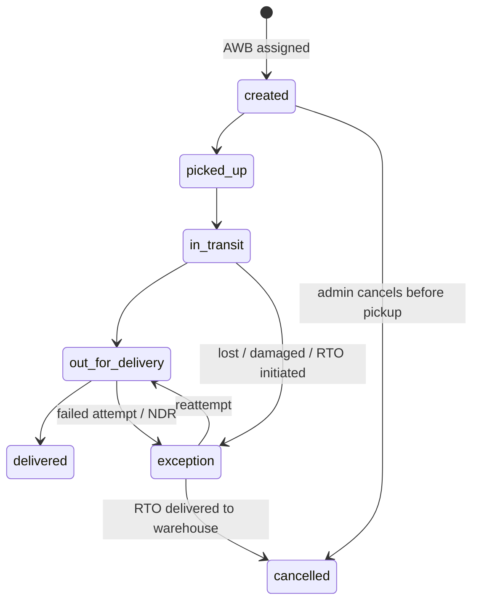
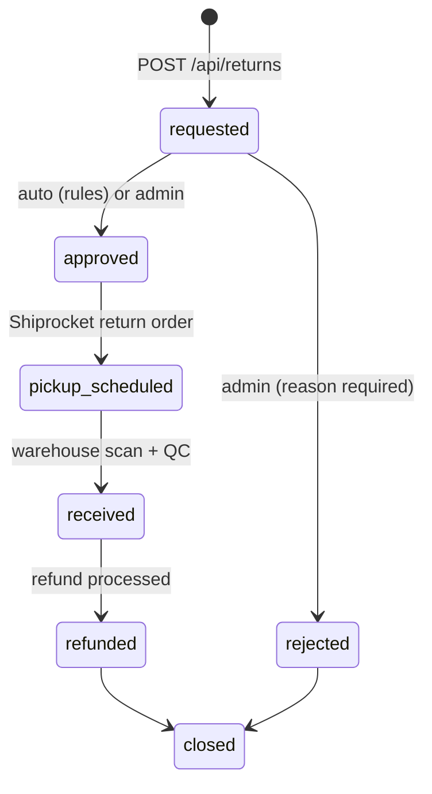

# 04 · Order Lifecycle and Tracking

The three state machines below use the SRS §2 states exactly, as mirrored in
`src/types/domain.ts`. Every transition is one SQL function call that also:
1. appends to `order_events` (`order_id, from, to, actor_type, actor_id, reason, meta, at`);
2. writes to `outbox` in the same transaction (notifications, analytics, Shiprocket);
3. is rejected with `409 invalid_transition {from,to}` if it is not in the allowed-transition table.

## 1. Order

| From → To | Trigger | Actor | Side effects (outbox) |
|---|---|---|---|
| — → `pending_payment` | `place_order()` | customer | PostHog `checkout_started`, `order_created` |
| `pending_payment` → `paid` | `confirm_payment()` | system | email **Order confirmed**; `payment_succeeded`; GA4 `purchase` (server via Measurement Protocol) |
| `paid` → `processing` | same transaction as paid | system | `shipping.create_order` job (Shiprocket `POST /orders/create/adhoc`) |
| `pending_payment` → `processing` | `confirm_cod()` | system | email **Order confirmed (COD)** |
| `processing` → `packed` | `POST /api/admin/orders/[id]/pack` | order_manager | assign AWB (`/courier/assign/awb`), generate label, schedule pickup (`/courier/generate/pickup`) |
| `packed` → `shipped` | Shiprocket webhook `PICKED UP` | system | email **Shipped** with `/track/[token]` link |
| `shipped` → `delivered` | webhook `DELIVERED` | system | email **Delivered + review request (T+3 days)**; `order_delivered`; return window starts (7 days, `settings.returns.window_days`) |
| any pre-`packed` → `cancelled` | `POST /api/orders/[id]/cancel` (customer, before packed) or admin | customer / order_manager | release/restock, refund via 03 §9, email **Cancelled** |
| `pending_payment` → `cancelled` | `pg_cron` 24 h unpaid | system | no email (never paid) |
| `delivered` → `return_requested` | `POST /api/returns` | customer | email **Return received** |
| `return_requested` → `returned` | return shipment `received` | order_manager | restock if QC pass |
| `returned` → `refunded` | `refund.processed` | system | email **Refund processed** with amount and UTR/ARN |

Order `payment_status` is derived from its attempts and refunds (`initiated`, `captured`,
`partially_refunded`, `refunded`) and stored on `orders` for list filtering.

## 2. Shipment

Shiprocket status mapping (`src/backend/shipping/providers/shiprocket.ts`, `mapStatus()`):

| Shiprocket `current_status` / `shipment_status_id` | Ours |
|---|---|
| `NEW`, `AWB ASSIGNED`, `LABEL GENERATED`, `PICKUP SCHEDULED`, `PICKUP QUEUED` | `created` |
| `PICKED UP` | `picked_up` |
| `SHIPPED`, `IN TRANSIT`, `REACHED AT DESTINATION HUB`, `MISROUTED` | `in_transit` |
| `OUT FOR DELIVERY` | `out_for_delivery` |
| `DELIVERED` | `delivered` |
| `UNDELIVERED`, `NDR`, `LOST`, `DAMAGED`, `RTO INITIATED`, `RTO IN TRANSIT` | `exception` (sub-code kept in `shipment_events.raw_status`) |
| `CANCELED`, `RTO DELIVERED` | `cancelled` |

Unknown statuses map to the current state, append an event with `raw_status`, and log
`shipment.unknown_status` at warn level, so tracking never breaks on a new courier label.

Tables: `shipments(id, order_id, provider, provider_order_id, provider_shipment_id, awb, courier, status, eta, label_url, pickup_scheduled_at, delivered_at, last_synced_at)` and `shipment_events(id, shipment_id, status, raw_status, location, note, occurred_at, source, dedupe_key unique)`.

## 3. Return

Eligibility (`GET /api/orders/[id]/eligible-actions` → `returns.eligibility()`):
- the order is `delivered` and `now() < delivered_at + window_days` (default 7);
- the item's category allows returns (sneakers unworn only; innerwear excluded via `categories.returnable=false`);
- the item has not already been returned;
- it is not a final-sale product (badge `final_sale`).

**Auto-approve** applies when the reason is in (`size_issue`, `changed_mind`), the item value is ≤ ₹5,000, and the customer has had fewer than 3 returns in the last 90 days. Everything else goes to the admin queue `/admin/returns`.
Evidence photos (required for `damaged` / `wrong_item`) are uploaded to the private
`return-evidence` bucket via signed upload URL, max 5 × 8 MB, `image/jpeg|png|webp`.

## 4. Shiprocket integration

| Action | Shiprocket API | Called from | Retry |
|---|---|---|---|
| Auth token | `POST /v1/external/auth/login` | `providers/shiprocket.ts`; token cached 9 days in `integration_configs.meta.token_expires_at` (encrypted via `pgsodium`/Vault) | refresh on 401 once |
| Serviceability / ETA / COD | `GET /courier/serviceability?pickup_postcode&delivery_postcode&weight&cod` | PDP delivery check `GET /api/shipping/serviceability?pincode=`, checkout shipping step | cached 6 h per (pincode, weight bucket) |
| Create order | `POST /orders/create/adhoc` | outbox job `shipping.create_order` after `paid` / COD confirmed | backoff 1, 5, 15, 60 min; dead after 8 → alert |
| Assign AWB | `POST /courier/assign/awb` | admin Pack action | manual retry button |
| Pickup | `POST /courier/generate/pickup` | admin Pack action | |
| Label | `POST /courier/generate/label` | admin | |
| Cancel | `POST /orders/cancel` | order cancel before pickup | |
| Return order | `POST /orders/create/return` | return approved | |
| Track (fallback poll) | `GET /courier/track/awb/{awb}` | `shiprocket-sync` cron every 30 min for shipments with no event in 6 h | |

### Webhook ingestion

`POST /api/hooks/courier-status`:

Shiprocket rejects webhook URLs that contain "shiprocket", "kartrocket", "sr" or "kr", so this path uses a neutral name. It calls `shipping.ingestWebhook()`.

1. **Auth.** Shiprocket sends a static token header (`x-api-key`) configured in its dashboard. It is compared with `timingSafeEqual` to `SHIPROCKET_WEBHOOK_TOKEN`. Mismatch → `401`.
2. Parse the JSON and find the shipment by `awb`. If none is found, store it in `webhook_inbox(status='orphan')` and return `200`.
3. `dedupe_key = awb + ':' + current_status + ':' + current_timestamp`, then insert `shipment_events ON CONFLICT DO NOTHING`. A duplicate returns `200` with no-op.
4. `advance_shipment(shipment_id, mapped_status, event)`. This ignores regressions: events with `occurred_at` older than the latest event are only appended to history. It updates the order state when needed (`picked_up` → order `shipped`, `delivered` → order `delivered`).
5. Respond `200` within 1 s. All heavy work (emails) goes through the outbox.

## 5. Public tracking link

- **Token:** `orders.tracking_token` holds 22 chars of base62, 128-bit random from `gen_random_bytes(16)`, created at order placement. It is unguessable and not derived from the order number. `order_number` is never enough to track.
- **Page:** `/track/[token]` (dynamic, `noindex`, `Referrer-Policy: no-referrer`).
- **API:** `GET /api/track/[token]` → `{ orderNumber, status, placedAt, items:[{name,image,size,color,qty}], shipment:{carrier, awb, status, eta, events[]}, deliveryCity }`. It uses the service role on the server and returns only this whitelist. No address line, phone, email or price is exposed. Unknown token → `404`. Rate limit 30/min/IP.
- The link appears in the Shipped/Delivered emails, on order success, and in `/account/orders/[id]`. Logged-in customers see full detail in their account instead.
- Logging: `logger.ts` redacts keys matching `token`, so log `trackingTokenPrefix` (first 4 chars) rather than the token.
- Admin can rotate the token (`POST /api/admin/orders/[id]/rotate-tracking-token`). The action is audited and invalidates old links.

## 6. Notifications (Resend)

All emails go through `outbox(topic='email', dedupe_key)` → `notifications.send(template, to, data)`
→ Resend `POST /emails`, with `Idempotency-Key = dedupe_key`. Templates live in
`src/backend/notifications/templates/*.tsx` (React Email), with sender `wavy <orders@mail.wavy.in>`
and reply-to `support@`.

| Trigger | Template | Dedupe key | Delay |
|---|---|---|---|
| signup | `welcome` | `email:welcome:<userId>` | 0 |
| password reset / magic link | Supabase Auth (custom SMTP = Resend) | — | 0 |
| order `paid` / COD confirmed | `order_confirmed` | `email:order_confirmed:<orderId>` | 0 |
| payment failed (all attempts failed, order still `pending_payment` 30 min later) | `payment_failed_recover` | `email:pay_failed:<orderId>` | 30 min, only if not paid since |
| duplicate/late payment auto-refund | `payment_refunded_auto` | `email:auto_refund:<refundId>` | 0 |
| order `cancelled` (after paid) | `order_cancelled` | `email:order_cancelled:<orderId>` | 0 |
| shipment `picked_up` | `order_shipped` (includes `/track/[token]`) | `email:shipped:<shipmentId>` | 0 |
| shipment `out_for_delivery` | `out_for_delivery` | `email:ofd:<shipmentId>:<date>` | 0 |
| shipment `exception` (NDR) | `delivery_issue` | `email:ndr:<shipmentId>:<eventId>` | 0 |
| shipment `delivered` | `order_delivered` | `email:delivered:<shipmentId>` | 0 |
| delivered + 3 days | `review_request` | `email:review_req:<orderId>` | 3 d |
| return `requested` / `approved` / `rejected` / `pickup_scheduled` | `return_<state>` | `email:return:<returnId>:<state>` | 0 |
| refund `processed` | `refund_processed` | `email:refund:<refundId>` | 0 |
| staff invite | `staff_invite` | `email:invite:<inviteId>` | 0 |

Resend delivery webhooks (`POST /api/notifications/resend/webhook`, Svix signature) update
`notifications(status: queued/sent/delivered/bounced/complained)`. Hard bounces set
`profiles.email_status = 'bounced'` and are shown in the support view.
