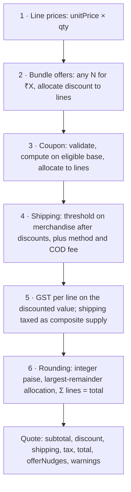

# 06 · Pricing, Tax and Offers

One pure function computes every total the customer ever sees: in the cart drawer, `/cart`, the
checkout steps, and the order snapshot.

```ts
// src/backend/pricing/service.ts  (pure: no I/O; repo loads inputs)
export function quote(input: {
  lines: { variantId: string; productId: string; categoryId: string; collectionIds: string[];
           unitPrice: number; quantity: number; tags: string[] }[];
  offers: Offer[];            // active bundle offers, ordered by priority
  coupon?: Coupon;            // already loaded by code, not yet validated
  shipping: ShippingSettings; // threshold, flat fee, express fee, COD fee
  tax: TaxSettings;           // mode, default rate, slab rules, store state
  shipTo?: { state: string; pincode: string };
  method?: "standard" | "express"; payment?: PaymentProvider;
  customer?: { id: string; ordersCount: number; couponUses: Record<string, number> };
}): Quote   // CartTotals + per-line breakdown + nudges + warnings
```

- Every amount is **integer paise**. No floats are stored. A percentage is computed as `Math.round(x * pct / 100)` (half-up, amounts are always positive), and only at the points listed below.
- Client-sent prices are ignored. `unitPrice` is read from `product_variants.price` at quote time.
- The same `quote()` runs inside `POST /api/checkout`. Its output is written to `orders.totals` and `order_items` (`unit_price`, `offer_discount`, `coupon_discount`, `taxable_value`, `tax_rate`, `tax_amount`, `line_total`) as the immutable snapshot.
- Tested in `pricing/service.test.ts` with the three worked examples below as fixtures.

## 1. Order of operations



### Step 1 · Line prices
`lineGross = unitPrice × quantity`, and `subtotal = Σ lineGross`. `compareAt` is display only.
Lines whose variant is not `active` or has `stock − reserved < quantity` return
`warnings: [{variantId, code: "out_of_stock" | "qty_reduced"}]` and are excluded from totals.

### Step 2 · Bundle offers

Stored in `offers(id, name, type 'bundle_fixed_price', status, priority, starts_at, ends_at, bundle_size, bundle_price, eligible jsonb {collectionIds, categoryIds, productIds, excludeTags}, combinable_with_coupons bool, nudge_max_missing int default 2, allocation 'highest_first')`.

Offer states follow Coupon states in the SRS: `draft/active/paused/expired/archived`.

Algorithm per offer, in `priority` order:
1. Expand eligible lines to units that are not already claimed by a higher-priority offer.
2. Sort units by `unitPrice` descending. `highest_first` gives the customer the best deal and matches what shoppers expect from "any 3".
3. `bundles = floor(units / bundle_size)`. For each bundle, `discount = Σ unit prices − bundle_price`, but only if that is positive; otherwise skip the bundle. A bundle must never raise the price.
4. Allocate each bundle's discount to its units pro-rata by price, using the largest-remainder method so the pieces add up exactly. Then sum per line into `offerDiscount`.
5. **Nudge.** `missing = bundle_size − (units mod bundle_size)`. If `0 < missing ≤ nudge_max_missing`, add `{offerId, itemsNeeded: missing, message: "Add 1 more tee to get 3 for ₹999"}`. The noun comes from `offers.nudge_noun`. The UI shows this in the cart drawer and `/cart`, with a link to the offer's collection.

### Step 3 · Coupons

`coupons(id, code citext unique, type 'percent'|'fixed'|'free_shipping', value, max_discount, min_subtotal, starts_at, ends_at, status, usage_limit, per_customer_limit, first_order_only, eligible jsonb, combinable_with_offers bool default false)`, plus `coupon_redemptions(coupon_id, order_id, user_id, email_hash, status 'reserved'|'redeemed'|'released', amount)`.

Stacking rules:
- **At most one coupon per order.** Applying a second one replaces the first. There is no coupon stacking.
- Bundle offers are automatic and can coexist with a coupon. When `combinable_with_offers = false` (the default), units already inside a bundle are **excluded from the coupon base**. The coupon still applies to the rest of the cart.
- `free_shipping` coupons set shipping to 0 in step 4 and never reduce merchandise value.

Validation (every rule is checked on the server; each failure returns a specific code shown under the input):

| Check | Error code |
|---|---|
| exists, `status='active'`, now within validity | `coupon_invalid`, `coupon_expired` |
| `min_subtotal ≤` eligible base after offers | `coupon_min_not_met` (message includes the shortfall: "Add ₹420 more") |
| `usage_limit` not reached (counting `reserved + redeemed`) | `coupon_exhausted` |
| `per_customer_limit` for user id **or** email hash (guest) | `coupon_already_used` |
| `first_order_only` and customer has a paid order | `coupon_first_order_only` |
| eligible base > 0 | `coupon_not_applicable` ("Doesn't apply to offer items") |
| rate limit 10 tries / 10 min / cart | `coupon_rate_limited` |

Computation:
- `percent`: `discount = min(round(base × value / 100), max_discount)`
- `fixed`: `min(value, base)`

The discount is allocated across eligible lines by largest remainder. The redemption is
**reserved** in `place_order()` with a conditional insert that counts limits under an advisory lock
on `coupon_id`. It becomes `redeemed` in `confirm_payment()` and is `released` when the order
is cancelled or the reservation expires.

### Step 4 · Shipping

Settings (`/admin/settings/shipping`): `free_threshold` (default ₹1,499), `standard_fee` ₹99,
`express_fee` ₹149 (only if Shiprocket serviceability returns an express courier), `cod_fee` ₹49.

`merchandise = subtotal − offerDiscount − couponDiscount`.
- `standard`: `shipping = merchandise ≥ free_threshold ? 0 : standard_fee`
- `express`: always `express_fee`
- If `payment = cod`, add `cod_fee` as a separate line (`codFee`, included in `shipping` in `CartTotals`).
- A `free_shipping` coupon zeroes the standard fee but not express or COD fees.

Nudge: if `free_threshold − merchandise ≤ ₹500`, show "₹X away from free shipping".

### Step 5 · GST

Settings (`/admin/settings/tax`, super_admin):

| Setting | Default | Notes |
|---|---|---|
| `price_mode` | `inclusive` | Indian B2C shows GST-inclusive prices. `exclusive` adds tax on top. |
| `default_rate` | 5% | Used when no slab or category rule matches |
| `slab_rules` | apparel and footwear: 5% if taxable value per unit ≤ ₹2,500, else 18% | Admin-editable table `tax_rules(category_id nullable, max_unit_value nullable, rate)`. Confirm the rates with the CA whenever GST notifications change. |
| `shipping_tax` | `highest_line_rate` | Shipping is treated as a composite supply that follows the principal supply. Alternatives: `fixed_rate`, `exempt`. |
| `store_state` | `KA` (GSTIN state) | Intra-state gives CGST + SGST (half each); otherwise IGST |
| `gstin` | — | Printed on the invoice |

Per line: `taxableUnitValue = (lineGross − offerDiscount − couponDiscount) / quantity`, which is used only to pick the slab. Then:
- **inclusive:** `lineTax = round(lineNet × r / (100 + r))`; the total does not change.
- **exclusive:** `lineTax = round(lineNet × r / 100)`; `total += lineTax`.

Shipping and COD fees are taxed the same way at the shipping rate.

### Step 6 · Rounding
- Tax is rounded **per line**, half-up. The invoice therefore matches the sum of the lines exactly, with no invoice-level rounding difference.
- Discount allocation uses largest remainder. Ties go to the earlier cart line, so the result is deterministic.
- `total = merchandise + shipping (+ tax if exclusive)`. There is no rounding to whole rupees; Razorpay and PayU accept paise.
- The payment `amount` sent to the provider must equal `orders.total` exactly. `confirm_payment()` rejects any mismatch.

## 2. Worked examples

Common settings: inclusive mode, slabs 5% (≤ ₹2,500/unit) and 18% (above), free shipping at
₹1,499 or more, otherwise ₹99. Offer **"Any 3 tees for ₹999"** on collection `essentials-tees`
(`bundle_size = 3`, `bundle_price = 99900`, not combinable with coupons).

### A · Two tees, offer not yet unlocked

| Line | Paise |
|---|---|
| Core Tee ₹599 × 2 | 119800 |
| Subtotal | **119800** |
| Offer: 2 eligible units, `missing = 1` → nudge "Add 1 more tee to get 3 for ₹999" | 0 |
| Merchandise | 119800 |
| Shipping (1,198 < 1,499) | 9900 |
| **Total** | **129700** (₹1,297.00) |
| GST included: goods `round(119800 × 5/105)` = 5705, shipping at 5% `round(9900 × 5/105)` = 471 | **6176** (₹61.76) |

### B · Three tees + hoodie + coupon

Cart: Core Tee ₹599, Core Tee ₹599 (another colour), Transit Tee ₹649, Daybreak Hoodie ₹2,999 (not
eligible for the offer). Coupon **WELCOME10**: 10%, max ₹300, min ₹1,999, not combinable with offers.

| Step | Calculation | Paise |
|---|---|---|
| 1 Subtotal | 59900 + 59900 + 64900 + 299900 | **484600** |
| 2 Bundle | tees Σ = 184700 → price 99900 → discount **84800**; allocated 27502 / 27501 / 29797 → tee nets 32398 / 32399 / 35103 | −84800 |
| 3 Coupon base | bundled units excluded → hoodie only = 299900 ≥ min 199900 ✓ | |
| 3 Coupon | `min(round(299900 × 10/100), 30000)` = 29990 → all allocated to the hoodie → hoodie net 269910 | −29990 |
| Merchandise | 32398 + 32399 + 35103 + 269910 | **369810** |
| 4 Shipping | 3,698.10 ≥ 1,499 → free | 0 |
| **Total** | | **369810** (₹3,698.10) |
| 5 GST (included) | tees at 5% (unit ≤ ₹2,500): 1543 + 1543 + 1672 = 4758; hoodie ₹2,699.10 > ₹2,500 → 18%: `round(269910 × 18/118)` = 41173 | **45931** |
| Split (ship-to KA = store state) | CGST 22967 + SGST 22964 (split per line, odd paise to CGST) | |

`CartTotals` = `{subtotal: 484600, discount: 114790, shipping: 0, tax: 45931, total: 369810, appliedCoupon: "WELCOME10", offerNudges: []}`.

### C · Exclusive mode, fixed coupon, inter-state

Setting `price_mode = exclusive`. Studio Runner sneaker ₹4,000 (price before tax), coupon **FLAT500**
(fixed ₹500), shipped to MH from a KA store.

| Step | Paise |
|---|---|
| Subtotal | 400000 |
| Coupon | −50000 |
| Merchandise (net) | 350000 → unit ₹3,500 > ₹2,500 → 18% |
| Shipping | 0 (≥ threshold) |
| IGST `round(350000 × 18/100)` | +63000 |
| **Total** | **413000** (₹4,130.00) |

## 3. API surface

| Endpoint | Returns |
|---|---|
| `GET /api/cart` | lines + `quote()` (without address: shipping estimated from threshold only, tax in inclusive mode) |
| `POST /api/cart/coupon {code}` / `DELETE /api/cart/coupon` | new quote, or a coupon error code |
| `POST /api/checkout/quote {cartId, shipTo, method, provider}` | full quote with shipping and GST split |
| `POST /api/checkout` | recomputes the quote. If the total differs from the one the client displayed (`expectedTotal`), returns `409 price_changed` with the new quote. The customer confirms again, so nobody is ever charged a number they didn't see. |
