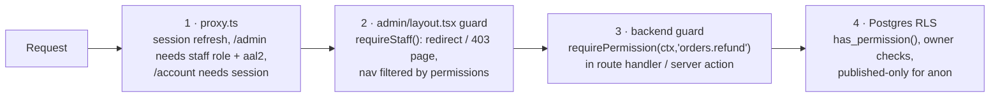

# 07 · Security and RBAC

## 1. Auth flows (Supabase Auth, `@supabase/ssr` cookies)

| Actor | Flow | Details |
|---|---|---|
| Guest | none | Cart is keyed by the `bb_cart` cookie (httpOnly, uuid). Checkout collects email + phone. The order is readable afterwards only via `/order/[number]/success?k=<order_access_key>` (single session) or `/track/[token]`. |
| Customer signup | `POST /api/auth/signup` → `supabase.auth.signUp` | email + password (min 8 chars, HIBP-leaked check on); email confirmation required before the first login. The guest cart and past guest orders with the same verified email are merged on confirmation. |
| Customer login | `POST /api/auth/login` (password) or magic link | Session cookie `sb-*` (httpOnly, Secure, SameSite=Lax). Access token 1 h, refresh token rotated, refreshed in `proxy.ts`. |
| Recovery | `POST /api/auth/recover` → email link → `/account/reset` | Always responds 200, which prevents account enumeration. |
| Staff invite | super_admin `POST /api/admin/staff/invite {email, role}` → `auth.admin.inviteUserByEmail(redirectTo=/admin/accept-invite)` + `staff_invites(email, role, invited_by, expires_at 72h)` | On accept: set password, **enrol TOTP MFA (mandatory)**, then `profiles.role` is set from the invite, and the invite is consumed and audited. |
| Staff login | `/admin/login` → password → TOTP challenge | `/admin/**` requires `aal2`. Idle timeout 30 min (enforced by checking `last_activity` in `proxy.ts`), absolute 12 h. |
| Admin (super_admin) | same as staff | The first super_admin is seeded by SQL (`supabase/seed.sql` / manual). No UI can create a super_admin except another super_admin, and that needs re-auth (password + TOTP within the last 5 min). |
| Role change / offboarding | `PATCH /api/admin/staff/[id] {role}` / `DELETE` | `auth.admin.signOut(userId, 'global')` revokes sessions immediately. Audited. |

**Role in the JWT.** A Supabase **Custom Access Token Hook** (`public.custom_access_token_hook`)
copies `profiles.role` into the `user_role` claim. Server code reads it via `supabase.auth.getClaims()`,
which verifies the JWT signature. Because a role change only reaches the JWT on the next refresh
(≤ 1 h), privileged endpoints also re-read `profiles.role` from the DB. That lookup is cached for
the length of the request only.

## 2. Roles and permission matrix

`role_permissions(role user_role, permission text)` is seeded by migration. It is the single source
for the backend guard, for RLS (`has_permission()`), and for filtering the admin nav.

Legend: ● full, ◐ read-only, blank = none.

| Permission | super_admin | catalog_manager | order_manager | marketing_manager | analyst | support_agent | customer |
|---|:-:|:-:|:-:|:-:|:-:|:-:|:-:|
| `dashboard.view` | ● | ● | ● | ● | ● | ● | |
| `catalog.read` | ● | ● | ◐ | ◐ | ◐ | ◐ | public (published only) |
| `catalog.write` (products, variants, media, categories, collections) | ● | ● | | | | | |
| `catalog.publish` | ● | ● | | | | | |
| `inventory.adjust` | ● | ● | | | | | |
| `orders.read` | ● | ◐ | ● | | ◐ (aggregate) | ● | own |
| `orders.update` (pack, cancel, notes) | ● | | ● | | | | own cancel (pre-pack) |
| `orders.refund` (≤ ₹20k; above needs super_admin) | ● | | ● | | | | |
| `returns.manage` | ● | | ● | | | ◐ | own create |
| `shipping.manage` (Shiprocket actions) | ● | | ● | | | | |
| `customers.read` | ● | | ● | ◐ (segments, no PII) | | ● | own |
| `customers.pii_export` | ● | | | | | | |
| `support.view` / `support.tickets` | ● | | ● | | | ● | own tickets |
| `reviews.moderate` | ● | ● | | ● | | | own create |
| `content.write` (testimonials, FAQ, About, Lookbook, blog) | ● | | | ● | | | |
| `marketing.coupons` / `marketing.offers` | ● | | | ● | | | |
| `marketing.campaigns` | ● | | | ● | | | |
| `seo.manage` | ● | ◐ (product SEO fields ●) | | ● | | | |
| `settings.shipping` | ● | | ● | | | | |
| `settings.payments` / `settings.tax` | ● | | | | | | |
| `integrations.manage` | ● | | | | | | |
| `integrations.view` | ● | ◐ | ◐ | ◐ | ◐ | ◐ | |
| `staff.manage` | ● | | | | | | |
| `audit.read` | ● | | | | ◐ (own module) | | |

Rules:
- `support_agent` is the SRS roles plus one: support staff see PII and journeys, but cannot change catalog, prices or money.
- Least privilege by default. A new permission is granted to super_admin only until a migration grants it elsewhere.

## 3. Enforcement layers

| Layer | File | Checks | Failure |
|---|---|---|---|
| 1. Proxy | `src/proxy.ts` (matcher excludes `_next/static`, images, `/api/payments/*/webhook`, `/api/hooks/*`, `/api/cron/*`) | valid session; for `/admin/**` `user_role ≠ customer` and `aal = aal2`; for `/account/**` any session | redirect to `/admin/login?next=` or `/login?next=`; API → 401 |
| 2. Layout guard | `src/app/admin/layout.tsx` → `backend/_core/auth.ts` `requireStaff()` | re-verifies the claims server-side (the proxy is not trusted alone) and loads permissions | `forbidden()` → 403 page |
| 3. Backend guard | `backend/_core/auth.ts`: `requireUser()`, `requirePermission(perm)`, `requireOwner(resourceUserId)` | called first in **every** admin route handler and server action; in services for money actions (refund thresholds) | `ApiError(401,'unauthenticated')` / `ApiError(403,'forbidden')`, logged as `auth.denied` with `{perm, userId}` |
| 4. RLS | migrations `*_rls.sql` | anon: `products.status='published'`, variants of published products, approved reviews, published content. Customer: `user_id = auth.uid()` on `orders`, `addresses`, `wishlist_items`, `return_requests`, `reviews` (insert only when a verified purchase exists). Staff: `has_permission('…')`. | row invisible / insert denied |

Service-role usage (`lib/supabase/admin.ts`, bypasses RLS) is limited to:
- webhooks, cron jobs, and `/api/track/[token]` (which uses a column whitelist);
- admin services, and only **after** `requirePermission()`.

Lint rule: `import "@/lib/supabase/admin"` is only allowed under `src/backend/**`.

## 4. Secrets

- All secrets are Vercel env vars (Production / Preview scoped separately; preview uses test keys). None use the `NEXT_PUBLIC_` prefix except `NEXT_PUBLIC_SUPABASE_URL`, `NEXT_PUBLIC_SUPABASE_PUBLISHABLE_KEY` (and legacy `NEXT_PUBLIC_SUPABASE_ANON_KEY`), `NEXT_PUBLIC_POSTHOG_KEY` and `NEXT_PUBLIC_GA_ID`. Server-only keys like `SUPABASE_SECRET_KEY` (and legacy `SUPABASE_SERVICE_ROLE_KEY`) bypass RLS and must never be prefixed with `NEXT_PUBLIC_`.
- `lib/env.ts` validates server env with zod at boot and imports `server-only`.
- Integration secrets that admin must set at runtime (e.g. Shiprocket password, VTON API key) go into **Supabase Vault** (`vault.create_secret`). They are read only by `security definer` functions callable by the service role. The admin UI shows only `••••last4` and a "Replace" action.
- Rotation: webhook secrets every 12 months or on staff offboarding. For zero downtime, the Razorpay/PayU webhook handler accepts `*_WEBHOOK_SECRET` and `*_WEBHOOK_SECRET_PREVIOUS` during rotation.
- `logger.ts` redacts secret-like keys. Provider payloads stored in `payment_events` are redacted by the same function before insert.

## 5. Webhook verification

| Source | Endpoint | Verification |
|---|---|---|
| Razorpay | `POST /api/payments/razorpay/webhook` | `HMAC-SHA256(rawBody, RAZORPAY_WEBHOOK_SECRET)` vs `X-Razorpay-Signature`, `timingSafeEqual`; dedupe on `x-razorpay-event-id` |
| PayU | `POST /api/payments/payu/webhook`, `POST /api/payments/payu/return` | SHA-512 reverse hash with salt; then **server-to-server `verify_payment`** before confirming (PayU returns come through the browser) |
| Shiprocket | `POST /api/hooks/courier-status` | static token header vs `SHIPROCKET_WEBHOOK_TOKEN`; the payload is treated as a hint and state only moves forward (04 §4) |
| Resend | `POST /api/notifications/resend/webhook`, `/api/support/inbound` | Svix signature (`svix-id`, `svix-timestamp`, `svix-signature`), timestamp within 5 min |
| Cron | `/api/cron/*` | `Authorization: Bearer CRON_SECRET` |

All webhook handlers:
- read the raw body;
- enforce a 256 KB body limit;
- respond 2xx only after the event is durably stored;
- never trust amounts in a webhook without matching `payment_attempts.amount`.

## 6. Rate limiting

See 02 §5. It is enforced at two layers: Vercel Firewall (per IP) and the Postgres `rate_hit()`
function (per identity: cart, order, email). Auth endpoints also rely on Supabase Auth's built-in
limits (e.g. 30 sign-ins per 5 min per IP) and CAPTCHA (Turnstile) after 3 failed logins.

## 7. OWASP Top 10 (2021) checklist

| Risk | Control |
|---|---|
| A01 Broken access control | Four-layer RBAC (§3); RLS on every table (a CI check fails if any `public` table has RLS disabled); ownership checks on `/api/orders/[id]`; guests cannot guess order ids (uuid + access key); IDOR tests in vitest |
| A02 Cryptographic failures | TLS everywhere (HSTS `max-age=63072000; includeSubDomains; preload`); no card data; tracking tokens are 128-bit random; Vault for runtime secrets |
| A03 Injection | Supabase query builder / parameterised SQL functions only; no string-built SQL; zod on every input; React escapes output; blog Markdown rendered with a sanitiser (no raw HTML) |
| A04 Insecure design | Server-authoritative pricing; idempotency keys; state machines reject invalid transitions; abuse limits on coupons |
| A06 Vulnerable components | Dependabot + `npm audit --omit=dev` in CI; pinned Next/React; weekly update window |
| A07 Identification and auth failures | Supabase Auth, leaked-password check, TOTP MFA for staff, session revocation on role change, CAPTCHA after failures |
| A08 Software and data integrity | Webhook signatures; lockfile; Vercel deployment protection on previews; migrations reviewed before merge; no `eval` |
| A09 Logging and monitoring failures | Structured logs with request ids (05); `auth.denied`, `payment.signature_mismatch` alerts; `audit_logs` for high-impact admin actions (actor, action, entity, before/after, ip, ua, at), append-only (`REVOKE UPDATE, DELETE`) |
| A10 SSRF | No user-supplied URLs are fetched server-side; image URLs restricted to `images.remotePatterns` (Supabase host only); the provider base URLs are constants |

- signed upload URLs only;
- MIME and magic-byte check;
- EXIF stripped on processing;
- private buckets use signed read URLs with 5 min expiry;

## 8. PCI DSS scope

- **No card data ever touches wavy servers.** Razorpay Standard Checkout (iframe/modal on Razorpay's domain) and the PayU hosted page collect card, UPI and netbanking details. We receive only tokens and ids (`pay_…`, `mihpayid`).
- Scope: **SAQ-A**. Obligations:
  - HTTPS;
  - a CSP limiting script sources, so the checkout script cannot be swapped;
  - the integrity of the page that loads `checkout.js`;
  - staff access control;
  - annual SAQ-A self-assessment.
- It is forbidden to log or store PAN, CVV, expiry, UPI PIN or OTP. The logger redacts `card` and `cvv` keys as a backstop.
- Saved cards and UPI use the provider's tokenisation (RBI CoF rules). We store only the provider customer id.
- Data protection (DPDP Act 2023):
  - consent banner;
  - `/account/privacy` export and delete request, handled within 30 days;
