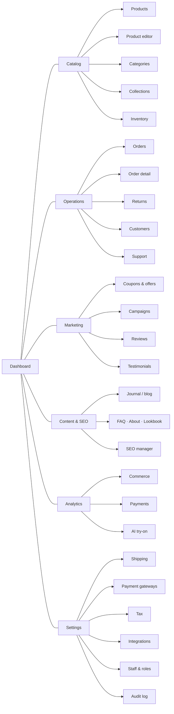

# 08 · Admin Modules

The admin shell is `src/components/layout/AdminShell.tsx`: a black rail (`bg-black text-on-dark`) with a
light content canvas. Routes live under `src/app/admin/**`, and each page renders
`src/views/admin-<module>/`. The rail shows only the modules the staff member has permission for
(07 §2). Every list uses the shared `DataTable` (search, filters, pagination 50/page,
bulk actions) with loading, empty and filtered-empty states. Every mutation of a high-impact
entity writes `audit_logs`.

## 1. Information architecture

## 2. Modules

| Module | Route | Permission | Key content and actions | Backing tables / APIs |
|---|---|---|---|---|
| Dashboard | `/admin` | `dashboard.view` | KPI tiles (today / 7 d / 30 d revenue, orders, AOV, conversion); orders needing action (paid but not packed > 24 h, NDR, return requests); low-stock list; integration alerts banner; payment failure rate by stage; open `reconciliation_issues`; shortcuts | `daily_metrics`, `v_ops_queue`, `integration_configs` |
| Products | `/admin/products` | `catalog.read` | table: image, name, category, status badge, variants count, stock sum, price range, updated; filters status/category/collection/stock; bulk publish/unpublish/archive | `products`, `product_variants` |
| Product editor | `/admin/products/[id]` | `catalog.write` | info (name, slug, descriptor, description, material, fit, care, badges); media (drag order, 4:5 crop, alt text required); variant matrix colour × size (SKU, price, compare-at, stock link, barcode, status); try-on enable and garment asset; SEO panel (§3); publish state + schedule; change history | `products`, `product_variants`, `product_media`, Storage `product-media`; `updateTag('product:<id>')` on save |
| Categories | `/admin/categories` | `catalog.write` | tree with drag reorder, parent, media, `returnable`, tax rule link, SEO | `categories` |
| Collections | `/admin/collections` | `catalog.write` | manual membership or rule (tag/category/price), hero media, SEO, status | `collections`, `collection_products` |
| Inventory | `/admin/inventory` | `inventory.adjust` | variant matrix per product: on-hand, reserved, available, low-stock threshold; adjustment with reason (`restock`, `damage`, `correction`, `return_restock`); CSV import (SKU,qty); movement ledger | `product_variants`, `inventory_movements`, `inventory_reservations` |
| Orders | `/admin/orders` | `orders.read` | table: number, date, customer, total, payment status, order status, shipment status, provider, flags (COD, high-value, signature alert); status tabs; export CSV | `orders`, `v_order_list` |
| Order detail | `/admin/orders/[id]` | `orders.read` / `orders.update` | items snapshot; totals breakdown (offer, coupon, GST split); **payments tab** (03 §10); shipment timeline; returns; internal notes; `order_events` timeline; actions: Pack, Cancel, Refund, Resend email, Rotate tracking link | `/api/admin/orders/[id]/*` |
| Returns | `/admin/returns` | `returns.manage` | queue by status; evidence viewer; approve/reject (reason), schedule pickup, QC receive (restock yes/no), refund | `return_requests`, `return_items` |
| Customers | `/admin/customers` | `customers.read` | list: name, email, orders, LTV, last order, returns; detail links to the support one-shot view | `profiles`, `v_customer_stats` |
| Support | `/admin/support` | `support.view` | tickets inbox, SLA, assignee; customer 360 view (05 §3) | `support_tickets`, `ticket_messages` |
| Reviews | `/admin/reviews` | `reviews.moderate` | tabs pending/approved/rejected/hidden; verified-purchase badge (derived, read-only); approve/reject/hide with reason; reply | `reviews`; `revalidateTag('reviews:<productId>')` |
| Review composer | `/admin/reviews/new` | `reviews.moderate` | editorial reviews for imported or legacy reviews, labelled `source=editorial`; **`verified_purchase` is always false and cannot be set** (PRD rule) | `reviews` |
| Testimonials | `/admin/testimonials` | `content.write` | list, author, quote, avatar, status, sort | `testimonials` |
| Coupons & offers | `/admin/marketing/coupons`, `/admin/marketing/offers` | `marketing.coupons` / `marketing.offers` | coupon form (06 §3 fields), usage and redemption list, pause/archive; bundle offers (06 §2) with live preview ("Cart of 3 tees → ₹999") and nudge copy | `coupons`, `coupon_redemptions`, `offers` |
| Campaigns | `/admin/marketing/campaigns` | `marketing.campaigns` | states draft → scheduled → live → paused → completed → archived; hero/banner placement (home hero, collection banner, announcement bar); linked products/collections/coupon; schedule; UTM builder; performance (views, CTR, orders, revenue via `campaign_viewed` + UTM) | `campaigns`, `campaign_placements` |
| Journal / blog | `/admin/content/journal` | `content.write` | Markdown editor with preview, cover, tags, author, linked products ("Shop the story"), schedule, SEO panel | `blog_posts`; tag `blog` |
| Pages | `/admin/content/pages` | `content.write` | FAQ (categories, Q/A, order), About blocks, Lookbook (looks with hotspots → products) | `content_pages`, `faq_items`, `lookbook_looks` |
| SEO manager | `/admin/seo` | `seo.manage` | see §3 | `seo_overrides`, `seo_settings`, `redirects` |
| Analytics | `/admin/analytics` | `analytics.read` | date range; revenue, orders, AOV, conversion; funnel; product/category tables; coupons and offers uptake; payments by provider/method/failure stage | `daily_metrics`, `analytics_events` (replica) |
| AI try-on analytics | `/admin/analytics/try-on` | `analytics.read` | generations, completion rate, failure classes (input vs provider), try-on → ATC, try-on → purchase, on-device vs cloud split, cloud cost/day, TTL compliance (assets deleted on time) | `tryon_sessions`, `analytics_events` |
| Shipping settings | `/admin/settings/shipping` | `settings.shipping` | pickup locations (Shiprocket pickup nickname), free threshold, fees, express toggle, COD toggle + max value + fee, dispatch SLA, return window days, returns courier, package presets (weight/dims per category) | `settings` (key `shipping`) |
| Payment gateways | `/admin/settings/payments` | `settings.payments` | per gateway: configured? (env), connection status, enabled toggle, default radio, display name, order, min/max amount; COD limits; test/live badge (03 §3) | `payment_gateways` |
| Tax settings | `/admin/settings/tax` | `settings.tax` | inclusive/exclusive, default rate, slab rules per category, shipping tax mode, GSTIN, store state, invoice prefix and next number | `settings` (key `tax`), `tax_rules` |
| Integrations | `/admin/settings/integrations` | `integrations.view` / `.manage` | cards for Razorpay, PayU, Shiprocket, Resend, GA4, PostHog, VTON provider: status (connected / needs attention / disconnected), last checked, last error, non-secret config, secret "Replace", **Test connection** (`POST /api/admin/integrations/[provider]/test`) | `integration_configs`, Vault |
| Staff & roles | `/admin/settings/staff` | `staff.manage` | staff list, role, MFA status, last login; invite; change role; deactivate; read-only permission matrix | `profiles`, `staff_invites`, `role_permissions` |
| Audit log | `/admin/settings/audit` | `audit.read` | filter by actor/entity/action/date; before/after diff; export | `audit_logs` |

## 3. SEO manager

| Area | Behaviour |
|---|---|
| Global defaults | `seo_settings`: site title template `%s · wavy`, default description, default OG image, Twitter handle, `organization` JSON-LD fields (name, logo, sameAs), and a `noindex` switch for the whole site (staging safety) |
| Per-route overrides | `seo_overrides(path text unique, title, description, og_image, canonical, noindex, json_ld jsonb, updated_by)`. `path` is an exact route such as `/sneakers` or `/journal`. `generateMetadata()` on each page merges: route defaults from `src/data` → entity SEO (product/category/collection/post) → override for the exact path, so the most specific value wins. |
| Product SEO | Fields in the product editor: title (≤ 60 chars counter), meta description (≤ 155), slug (auto; changing it creates a `redirects` row 301), OG image (defaults to the first image), `noindex`. A live SERP preview is shown. |
| JSON-LD | Generated server-side, never hand-written for standard types: `Product` + `Offer` / `AggregateOffer` (price in INR, availability from stock, `priceValidUntil` for campaign prices) + `AggregateRating` (approved reviews only, ≥ 1); `BreadcrumbList` on PDP/collections; `Organization` + `WebSite` + `SearchAction` on home; `Article` on journal posts; `FAQPage` on FAQ. Overrides can **add** custom JSON-LD blocks per path. |
| Sitemap | `app/sitemap.ts` produces a sitemap index split into `products`, `collections`, `categories`, `journal`, `pages`. Only `published` and not `noindex` entries appear, with `lastModified` from `updated_at`. Cached with tag `seo`, revalidated on publish. |
| Robots | `app/robots.ts`: allow `/`; disallow `/admin`, `/api`, `/checkout`, `/cart`, `/account`, `/track`, `/search?*`; sitemap URL. If the global `noindex` is on, it returns `Disallow: /`. |
| Redirects | `redirects(from_path, to_path, status 301/302, hits)`, applied in `proxy.ts` from a cached map (tag `seo`). Loops are detected on save. |
| Health | SEO list view flags: missing meta description, duplicate titles, images without alt text, products with `noindex`, 404s from logs (top 50) |

## 4. Shared admin patterns

- **Save model:** forms use react-hook-form + zod (the same schema as `backend/<svc>/schema.ts`). Server actions call the service and then `updateTag()`. Optimistic UI only for toggles.
- **Concurrency:** editors send `updated_at` as a version. The server rejects stale saves with `409 stale_write` and shows a "Reload to see changes by <name>" message.
- **Dangerous actions** (refund, archive product, delete coupon with redemptions, role change) use a confirm dialog that restates the entity and amount. Refunds over ₹20,000 require super_admin, and role changes require re-authentication.
- **Exports** (orders, customers) are an async job that produces a signed URL valid for 15 min. `customers.pii_export` is required for columns containing email or phone. Exports are audited.
- **Empty states** explain the next action, e.g. "No coupons yet. Create your first drop code."
- **Scroll:** Lenis is disabled in `/admin` (native scroll inside tables). Motion is limited to 150 ms fades.
